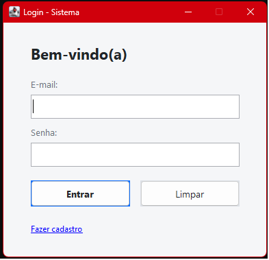
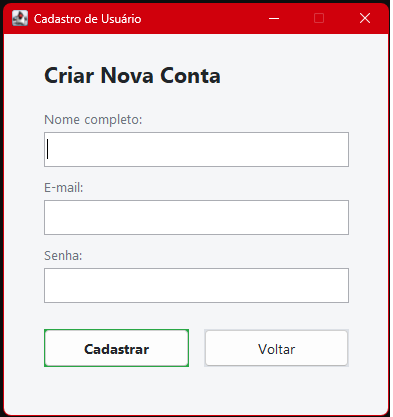
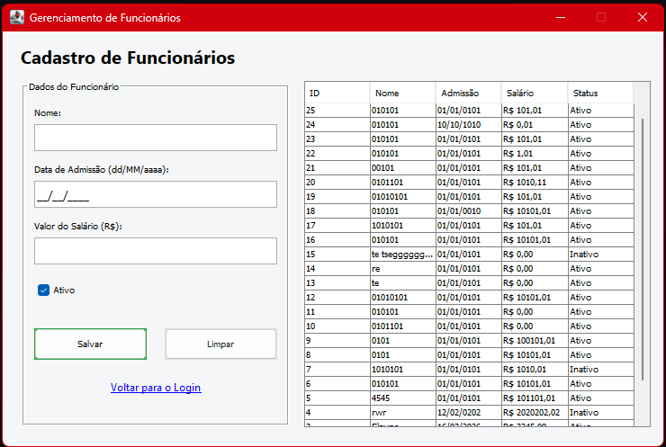

# Teste Prático – Vaga Programador | SISAUDCON – SAAM Auditoria

## 🎯 Sobre o Projeto (O que o projeto faz)

Este repositório apresenta a solução para o **Teste Prático da vaga de Programador** da **SISAUDCON – SAAM Auditoria**. 

Trata-se de uma aplicação desktop desenvolvida em **Java** com interface gráfica em **Java Swing** e persistência em banco de dados **PostgreSQL**. O sistema foi estruturado para gerenciar o acesso de usuários e o cadastro de funcionários.

As principais funcionalidades entregues pela aplicação são:

* **Controle de Acesso (Autenticação e Segurança):**
  * **Cadastro de Usuários:** Permite registrar novos usuários informando nome, e-mail e senha. As senhas são criptografadas utilizando o algoritmo **SHA-256** antes de serem salvas no banco de dados, garantindo a segurança das credenciais.
  * **Login no Sistema:** Valida as credenciais informadas pelo usuário contra os registros armazenados no banco PostgreSQL, permitindo o acesso apenas a usuários cadastrados.

* **Gestão de Funcionários:**
  * **Tela de Cadastro:** Permite registrar funcionários informando **Nome**, **Data de Admissão** (com máscara automática `dd/MM/yyyy`), **Valor do Salário** (com formatação monetária dinâmica em tempo real) e um **Status** (Ativo/Inativo).
  * **Listagem em Tempo Real:** Exibe todos os funcionários cadastrados diretamente em uma tabela organizada (`JTable`), facilitando a visualização e o acompanhamento dos dados inseridos.

* **Navegação e Experiência do Usuário (UX):**
  * Transição fluida entre as telas de Login, Cadastro e Gerenciamento de Funcionáriosisuais.


---

## 📸 Demonstração do Sistema (Telas)


<p align="center">

  <h3>Tela de Login</h3>

  <br><br>

  <h3>Tela de Cadastro de Usuário</h3>

  <br><br>

  <h3>Tela de Cadastro e Listagem de Funcionários</h3>

  

</p>

---


## 🚀 Tecnologias e Ferramentas Utilizadas


* **Linguagem:** Java

* **Interface Gráfica:** Java Swing

* **Banco de Dados:** PostgreSQL

* **Conexão:** Driver JDBC do PostgreSQL (`postgresql-42.7.14.jar`)

* **IDE de Desenvolvimento:** Apache NetBeans

* **Criptografia:** SHA-256


---


## 📂 Arquitetura e Organização do Projeto


O projeto segue uma arquitetura em camadas bem definida para garantir a separação de responsabilidades, manutenibilidade e boas práticas de código:


```text

FunGestao/

│

├── src/

│   ├── br.com.login.dao/         # Classes de Acesso a Dados (DAO) e conexões JDBC

│   │   ├── FuncionarioDAO.java

│   │   └── UsuarioDAO.java

│   │

│   ├── br.com.login.model/       # Classes de Domínio / Entidades POJO

│   │   ├── Funcionario.java

│   │   └── Usuario.java

│   │

│   ├── br.com.login.util/        # Classes utilitárias (ex: Criptografia SHA-256)

│   │   └── CriptografiaUtil.java

│   │

│   ├── br.com.login.view/        # Interfaces Gráficas (Telas em Java Swing)

│   │   ├── CadastroView.java

│   │   ├── FuncionarioView.java

│   │   └── LoginView.java

│   │

│   └── fungestao/                # Classe principal de inicialização

│       └── FunGestao.java

```


---


## 📋 Requisitos Atendidos do Teste


1. **Tela de Cadastro e Login:**

   * Tela de cadastro de novos usuários com validação de campos obrigatórios.

   * Criptografia de senha utilizando o algoritmo **SHA-256** antes de persistir no banco de dados.

   * Tela de login integrada validando o e-mail e a senha criptografada contra o banco PostgreSQL.

2. **Tela de Cadastro de Funcionários:**

   * Campos estruturados: Nome, Data de Admissão (com máscara automática `dd/MM/yyyy`), Valor do Salário (com formatação monetária dinâmica em tempo real) e Status (Ativo/Inativo).

   * Listagem de registros em tempo real utilizando uma **`JTable`** estilizada e protegida contra edições diretas.

3. **Banco de Dados PostgreSQL:**

   * Utilização de SQL nativo e JDBC para gerenciar conexões e transações.

   * Tratamento robusto de exceções e exibição de mensagens amigáveis via `JOptionPane` em caso de falhas de conexão ou consultas inválidas.


---


## 🛠️ Como Configurar e Executar o Projeto


### 1. Configuração do Banco de Dados PostgreSQL

Execute o script SQL nativo abaixo no seu cliente PostgreSQL (pgAdmin, DBeaver ou terminal) para criar o banco de dados e as tabelas necessárias:


```sql
-- Criar o banco de dados do projeto
CREATE DATABASE fungestao;

-- Criar as tabelas do sistema

CREATE TABLE usuario (

    id SERIAL PRIMARY KEY,

    nome VARCHAR(100) NOT NULL,

    email VARCHAR(100) UNIQUE NOT NULL,

    senha VARCHAR(64) NOT NULL

);


CREATE TABLE funcionario (

    id SERIAL PRIMARY KEY,

    nome VARCHAR(100) NOT NULL,

    data_admissao DATE NOT NULL,

    salario NUMERIC(10, 2) NOT NULL,

    status BOOLEAN NOT NULL

);

```


### 2. Configuração das Credenciais de Conexão

Nas classes DAO (`UsuarioDAO.java` e `FuncionarioDAO.java`), certifique-se de que os parâmetros de conexão apontam para o seu ambiente local do PostgreSQL:

```java

private static final String URL = "jdbc:postgresql://localhost:5432/fungestao";

private static final String USER = "postgres";

private static final String PASS = "sua_senha";

```


### 3. Abrindo e Executando no NetBeans

1. Abra o **Apache NetBeans**.

2. Vá em **File > Open Project** e selecione a pasta do projeto `FunGestao`.

3. Certifique-se de que o **Driver JDBC do PostgreSQL** está adicionado nas *Libraries* do projeto.

4. Localize a classe principal `FunGestao.java` (ou a `LoginView`), clique com o botão direito e selecione **Run File** (`Shift + F6`).


---


## 🔍 Tratamento de Erros e Validações

* **Validação de Campos:** O sistema impede o envio de formulários com campos vazios, formatos incorretos ou datas incompletas.
